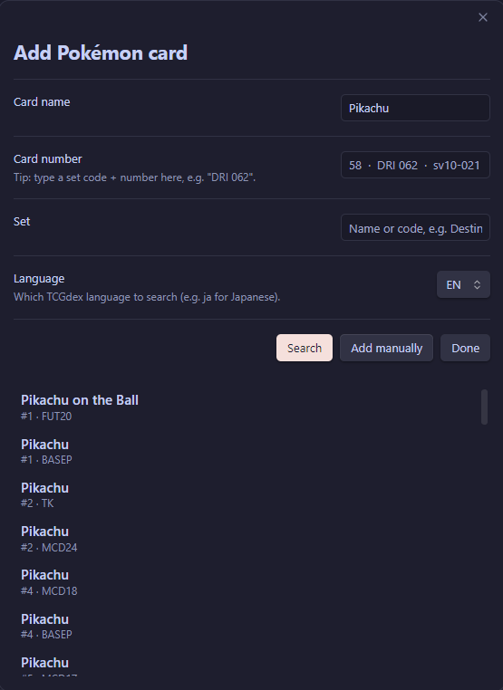

# Adding cards

There are five ways to add cards. All of them write to the **active note**, so open the note you want to add to first. They work in both Editing and Reading view.

| Method | Best for |
| --- | --- |
| [Search](#search) | Everyday use: find a card by name, set or number |
| [Set code + number](#set-code--number) | The fastest entry when you have the card in hand |
| [Cardmarket link](#from-a-cardmarket-link) | Cards you found or bought on Cardmarket |
| [Bulk add](#bulk-add) | Many cards at once from a typed or pasted list, in any mix of languages |
| [Manual card](#manual-cards) | Cards TCGdex doesn't know |

## Search



Run **Add card**. The search window has four fields:

- **Card name** — any part of the name (`pika`, `Charizard ex`).
- **Card number** — the collector number (`58`, `062`, `TG05`). Leading zeros don't matter.
- **Set** — a set name or code. As you type, matching sets are suggested; picking one limits the search to that set.
- **Language** — which TCGdex language to search, e.g. `JA` for Japanese cards. Set names are translated per language, so the set suggestions follow this choice.

Results appear as you type. Press **Enter** or click **Search** for a full search. Each result shows the card name, set code and number — and the card image when *Enable image previews* is on. Click a result to continue to the [variant step](#variant-condition-grade-and-price).

The window stays open after each card is added (a counter shows how many you added). The set and language are kept, the name and number are cleared, and you can type the next card straight away. Click **Done** to close it.

## Set code + number

Type the set code and the collector number into the **Card number** (or name) field, exactly as printed at the bottom of the card:

```
DRI 062
DRI062
dri-062
sv10-062
```

Both the short set code (`DRI`) and the TCGdex set id (`sv10`) are accepted. Localized codes work too — for example the French code `RVD` finds *Destined Rivals*.

When a single card matches, the variant step opens immediately. If a code is unknown, the plugin looks it up on TCGdex in the background. To make every code resolve instantly and offline, run **Rebuild Pokémon set index** once (see [Commands](commands.md)).

## From a Cardmarket link

Run **Add card from Cardmarket link** and paste a single-card URL such as:

```
https://www.cardmarket.com/en/Pokemon/Products/Singles/Destined-Rivals/Pikachu-DRI062
```

The plugin reads the card name, set and number from the link and opens the search window pre-filled, so you only need to pick the variant. Links with promo codes (`…/Trick-or-Trade-2023/Pikachu-BOO23PAL-062`) and search links (`…/Search?searchString=…`) are supported as well.

## Bulk add

Run **Bulk add cards from list** and enter one card per line:

```
CODE NUMBER [xQTY] [variant] [condition] [grade] [language]
```

Examples:

```
DRI 062
DRI 062 x2 reverse LP
PAF 091 holo PSA10
sv10-021 3x
swsh12.5 GG01 holo
sv7 055 JA
# lines starting with # are ignored
```

- **Quantity** can be written as `x2`, `2x` or `×2`.
- **Variant** is free text (`reverse`, `holo`, `holo 1st`, `Reverse Holo` …) and is matched to the card's real printings. If the card has no such printing, the text is kept as a custom variant and you get a warning.
- **Condition** is one of `NM`, `LP`, `MP`, `HP`, `DMG` (default `NM`).
- **Grade** is a grading company and number, e.g. `PSA10`, `CGC 9.5`, `BGS 9`.
- **Language** is a TCGdex language code such as `JA`, `FR` or `ZH-TW` (default: your *Preferred language*). Set ids differ per language — Japanese `SV7` (*Stellar Miracle*) is not an English set — so mark non-English cards with their language. You can mix languages in one list.

If a set code isn't found in the line's language, the error tells you which language does have it (e.g. *it exists in JA (ステラミラクル): add JA to the line*), or suggests the zero-padded English id (`sv7` → `sv07`).

Click **Add all**. Recognised cards are inserted together in one write. Lines that could not be resolved stay in the box with the reason, so you can fix and resubmit them.

## Manual cards

Some cards are not in TCGdex (certain promo bundles, regional printings, misprints). Use **Add card manually** — or the **Add manually** button in the search window — and enter the name, set, number, variant, condition, grade, language, quantity and price yourself.

Manual cards are tracked, counted and shown on the dashboard like any other card, but they have no image and no automatic price; their price is the one you enter.

## Variant, condition, grade and price

After you pick a card, the second window shows the card's set, number, rarity and a link to its Cardmarket page.

| Field | Notes |
| --- | --- |
| **Variant** | Only printings the card really has, from TCGdex: e.g. *Normal*, *Reverse Holo*, *Holo*, *Holo (1st Edition)*, *Holo (Shadowless)*, stamped or jumbo versions. A holo-only card never offers *Normal*. Choose **Custom…** for anything else (*Full Art*, *Alt Art*, *Error*). |
| **Condition** | `NM` Near Mint, `LP` Lightly Played, `MP` Moderately Played, `HP` Heavily Played, `DMG` Damaged. The price is adjusted with the [condition multiplier](prices.md#condition-pricing). |
| **Grade** | Leave empty for raw cards. For slabs enter e.g. `PSA 10`, `CGC 9.5`. Graded cards are never priced automatically. |
| **Language** | The label written to the Lang column (e.g. `EN`, `JA`). |
| **Quantity** | Defaults to the *Default quantity* setting. |
| **Price** | Filled in per variant and condition from the price source; edit it freely. |

### How duplicates are handled

A row is identified by **card + variant + condition + grade**. Adding the same combination again increases that row's quantity (and refreshes its price). A different variant, condition or grade gets its own row — so a Near Mint and a Lightly Played copy of the same card are tracked separately.

## Languages

TCGdex has data in 16 languages: `en`, `fr`, `de`, `es`, `it`, `pt`, `pt-br`, `nl`, `pl`, `ru`, `ja`, `ko`, `zh-cn`, `zh-tw`, `id`, `th`. The availability of cards, images and prices varies by language — English data is the most complete.

How to pick the language when adding:

- **Search window** — the **Language** dropdown.
- **Bulk add** — a language code at the end of a line, e.g. `sv7 055 JA`; lines without one use your *Preferred language*.

Asian releases have their own sets and set ids, which are not the same as the English ones even when the code looks similar: Japanese `SV7` is *Stellar Miracle*, while the English `sv07` is *Stellar Crown*, and Japanese `SV10` and English `sv10` are different sets too. Always add a card in the language it was printed in.

Cardmarket links are always built from the English version of a card, because Cardmarket uses English names. For cards that only exist in Japanese or another language, the plugin links to a Cardmarket search for the Pokémon's English name instead, or shows no link when no English name can be found (for example some Japanese trainer cards).
