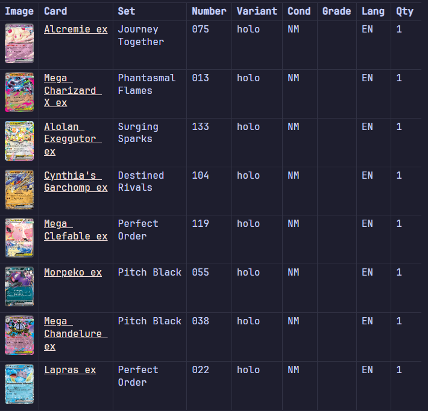

# The collection table

Your collection is stored as a Markdown table inside your notes. The table **is** your data: there is no hidden database. Everything else the plugin keeps (images, rarity, price history) is a cache that can be rebuilt.

In Reading view a table looks like this:



## Format

```markdown
<!-- pokemon-collection:start -->
| Image | Card | Set | Number | Variant | Cond | Grade | Lang | Qty | Price |
| --- | --- | --- | --- | --- | --- | --- | --- | --- | --- |
|  | [Pikachu](https://www.cardmarket.com/…)<!--k:sv10-003:reverse:NM--> | Destined Rivals | 003 | reverse | NM |  | EN | 2 | €4.00 |
| | [Charizard](https://www.cardmarket.com/…)<!--k:base1-4:holo-unlimited:NM:PSA 9--> | Base Set | 4 | holo-unlimited | NM | PSA 9 | EN | 1 | €1500.00 |
<!-- pokemon-collection:end -->
```

The plugin only reads and writes the text between the `pokemon-collection:start` and `pokemon-collection:end` markers. Everything else in the note — headings, notes, other tables — is never touched.

## Columns

| Column | Content |
| --- | --- |
| **Image** | Optional thumbnail (setting *Image column in table*). |
| **Card** | Card name, linked to its Cardmarket page, plus a hidden identity comment. |
| **Set** | Set name. |
| **Number** | Collector number as printed. |
| **Variant** | Printing: `normal`, `reverse`, `holo`, `holo-1st-edition`, `holo-shadowless`, … or custom text. |
| **Cond** | Condition: `NM`, `LP`, `MP`, `HP`, `DMG`. |
| **Grade** | Grade for slabbed cards, e.g. `PSA 10`; empty for raw cards. |
| **Lang** | Language label, e.g. `EN`, `JA`. |
| **Qty** | Number of copies. |
| **Price** | Price per copy, with its currency symbol (`€` or `$`). |

## The hidden identity comment

Each Card cell ends with an HTML comment such as `<!--k:sv10-003:reverse:NM-->`. It holds the row's identity — **card id : variant : condition [: grade]** — and is invisible in Reading view. It lets the plugin recognise the row even if you rename the card or change the set text, and it replaces a technical ID column that would otherwise clutter the table.

If the comment is deleted, the plugin tries to recover the card id from its cache by matching the card name and set. If that fails, the row is still kept and counted, but it can no longer be re-priced automatically.

## Editing by hand

You can edit the table directly in Editing view:

- **Qty**, **Price**, **Lang**, **Set** and **Number** can be changed freely.
- **Cond** and **Grade** can be changed too; the visible cell wins over the hidden comment, and the identity is updated the next time the plugin writes the table.
- To delete a card, delete its row.
- Keep the column headers and the two marker comments intact.

Older tables (for example with a visible ID column or without Cond/Grade columns) are still read correctly and are upgraded to the current format the next time the plugin writes the table.

## Sorting

- **Sort collection table** (command) — choose a field (card name, set, number, variant, language, condition, grade, quantity, price) and a direction. Applies to the table of the current note.
- **Click a column header** in Reading view to sort by that column; click again to reverse. Price, quantity, number and grade sort from high to low first. The sort is saved into the note.
- **Keep table sorted** (setting) — re-sorts automatically by your chosen field and direction after every add and price update.

Numbers sort naturally (`9` before `10`, `TG05` after `TG04`). Conditions sort from NM to DMG, grades by their numeric value.

## Price indicators

In Reading view, hover a price to see where it came from and when it was last updated ("Cardmarket price · updated 3 days ago"). Prices older than the *Stale price after* setting, and prices in a different currency than the active price source, are highlighted.

## Thumbnails

With *Image column in table* enabled (default), each row gets a small card image (at most 80 px wide). The setting is applied the next time the plugin rewrites the table — for example after adding a card, updating prices or sorting. Images are loaded from TCGdex when the note is displayed; nothing is stored in your vault.
