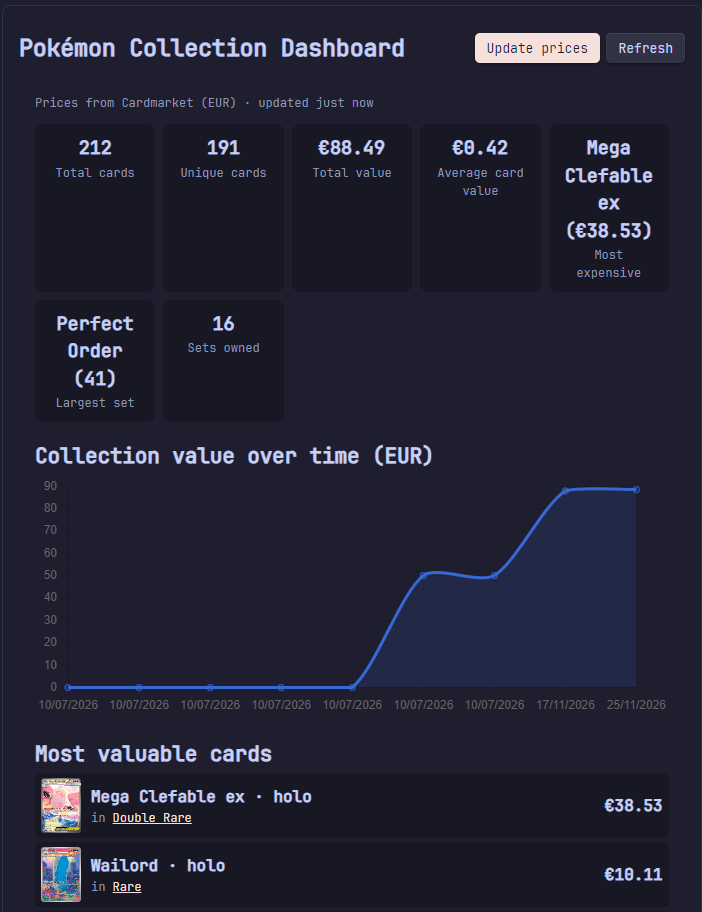

# Dashboard

The dashboard summarises every collection note in your collection folder. It lives inside a note as a code block, so you can place it anywhere, combine it with your own notes, or have several dashboards.



## Creating a dashboard

Run **Create dashboard note** to create (or open) `Pokemon/Pokémon Dashboard.md`, or add this block to any note:

````markdown
```pokemon-dashboard
```
````

The block has no options. Its content is calculated each time the note is opened.

### Buttons

| Button | What it does |
| --- | --- |
| **Update prices** | Fetches current prices for every collection note in the collection folder — the same as the *Update all collection prices* command, including a new value snapshot — then redraws the dashboard. |
| **Refresh** | Redraws the dashboard from the prices already in your notes. No network requests. |

## What it shows

### Price status

A line such as *Prices from Cardmarket (EUR) · updated 2 h ago*, with the number of cards whose price is older than the *Stale price after* setting. If some cards are still priced in another currency (after switching price source), a warning explains that they are not included in the totals.

### Statistics

| Tile | Meaning |
| --- | --- |
| Total cards | Sum of all quantities |
| Unique cards | Number of distinct card + variant + condition + grade rows |
| Total value | Sum of quantity × price, in the active currency |
| Average card value | Total value ÷ total cards |
| Most expensive | The highest-priced card |
| Largest set | The set with the most cards |
| Sets owned | Number of different sets |
| Graded | Number and value of graded cards (shown if you have any) |
| Wishlist | Cards on your wishlists and what they would cost (shown if you have a wishlist) |
| Trade | Cards on your trade lists and their value (shown if you have a trade list) |

Statistics count only **collection** notes; wishlists and trade lists have their own tiles. See [Wishlist and trade lists](lists.md).

### Charts and lists

- **Collection value over time** — one point per *Update all collection prices* run, in the active currency.
- **Most valuable cards** — the top 10 with image, price and the notes they are in. Click a card to open its price history.
- **Biggest movers** — the largest price rises and falls, either since the previous update or over the last 30 days.
- **Collection by set** and **Collection by rarity** — pie charts by quantity.
- **Collection by condition** — raw conditions and graded cards by grading company (shown when there is more than one group).
- **Collection growth** — the number of unique cards over time, by the date they were first added.

## Tips

- The value chart only grows when prices are updated (the **Update prices** button or the *Update all collection prices* command). Set an *Auto-update interval* if you want this to happen automatically.
- The dashboard uses the **collection folder** setting. If it shows "No cards found", check that your notes are inside that folder (or clear the setting to scan the whole vault).
